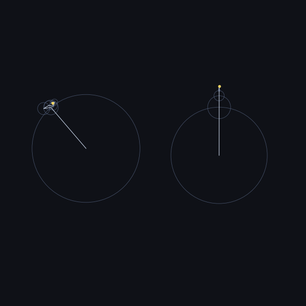

# fouriertrace

Turn any image with simple curves into **complex Fourier series**: coefficients, equations you can paste into Desmos, and a 3Blue1Brown-style epicycle animation.



## How it works

1. **Trace**: the image is thresholded (Otsu, or the alpha channel for transparent PNGs) and every outline is traced with OpenCV.
2. **Resample**: each closed outline becomes complex numbers `z = x + iy`, resampled evenly by arc length.
3. **FFT**: the curve is written as

   $$z(t) = \sum_n c_n e^{int}, \quad t \in [0, 2\pi)$$

   Each term is a circle with radius $|c_n|$ and starting angle $\arg c_n$, spinning $n$ times per loop (negative $n$ = clockwise). The largest `--terms` circles are kept.
4. **Export**: coefficients, equations, a preview, and optionally an animation.

## Install

```bash
git clone https://github.com/<your-username>/fouriertrace.git
cd fouriertrace
pip install -e .
```

## Usage

```bash
fouriertrace drawing.png                      # one series per curve -> out/
fouriertrace drawing.png -t 200 --animate     # more detail + epicycles.gif
fouriertrace drawing.png --join               # one series for the whole image
fouriertrace drawing.png --animate demo.mp4   # MP4 instead of GIF (needs ffmpeg)
fouriertrace drawing.png -t 10 --print        # print the equation in the terminal
```

### Printing the equation

`--print` (or `-p`) writes the series to the terminal. Use a small `-t` to get a short equation.

```console
$ fouriertrace heart.png -t 4 --print
z(t) = (0.4489 - 0.0001i) + 0.3258·e^(i(t + 1.5697)) + 0.0776·e^(i(-4t + 1.5737)) + 0.0347·e^(i(6t + 1.5638)) + 0.0062·e^(i(-14t + 1.5835))

$ fouriertrace heart.png -t 4 -p xy --digits 3
x(t) = 0.449 + 0.326·cos(t + 1.57) + 0.078·cos(-4t + 1.574) + ...
y(t) = 0 + 0.326·sin(t + 1.57) + 0.078·sin(-4t + 1.574) + ...
```

| Format | Looks like |
|---|---|
| `complex` (default) | `z(t) = c₀ + r·e^(i(nt + φ)) + …` |
| `xy` | `x(t) = Σ r·cos(nt + φ)`, `y(t) = Σ r·sin(nt + φ)` |
| `desmos` | `\left(…, …\right)`, ready to paste into Desmos |
| `latex` | `z(t) = (a+bi)e^{nit} + …` |

| Option | What it does |
|---|---|
| `-t, --terms` | Fourier terms kept per curve, biggest first (default 100) |
| `-n, --samples` | points sampled along each curve before the FFT (default 1024) |
| `--join` | chain all curves into one path, giving a single series (the jumps between curves get drawn too) |
| `--holes` | also trace inner outlines, like the inside of an "O" |
| `--invert` | treat light pixels as the drawing (normally auto-detected) |
| `--threshold` | fixed 0–255 threshold instead of automatic |
| `--pixels` | keep pixel units instead of normalising to [-1, 1] |
| `-p, --print [FORMAT]` | print the equation(s): `complex` (default), `xy`, `desmos` or `latex` |
| `--digits` | decimal places in printed equations (default 4) |
| `--animate [FILE]` | render the epicycle animation |
| `--frames`, `--circles` | animation length and circles drawn per curve |

### Output (in `out/`)

| File | Contents |
|---|---|
| `coefficients.json` / `.csv` | `n`, real/imag parts, radius and phase of every term, per curve |
| `desmos.txt` | one parametric `(x(t), y(t))` per curve: paste into [Desmos](https://www.desmos.com/calculator), set `0 ≤ t ≤ 2π` |
| `equations.tex` | the series written out in LaTeX |
| `preview.png` | reconstructed curves over the original outline |
| `mask.png` | the binary image that was traced (handy for debugging thresholds) |

## As a library

```python
from fouriertrace import load_binary, find_curves, to_math_coords, resample, fourier_series

mask = load_binary("drawing.png")
curves = to_math_coords(find_curves(mask), mask.shape[1], mask.shape[0])
series = fourier_series(resample(curves[0], 1024), terms=50)

for term in series.sorted_for_drawing()[:5]:
    print(term.n, term.radius, term.phase)
```

## Tips

- Works best with **high-contrast** images: dark shapes on a light background, or a transparent PNG.
- Thin pen strokes are traced around their **outside edge**, so a line drawing becomes the outline of the line.
- Fewer terms give smoother, rounder shapes; sharp corners need more terms.

## Examples and tests

```bash
python examples/make_examples.py   # writes sample images to examples/
pip install -e ".[dev]" && pytest
```

## License

MIT
